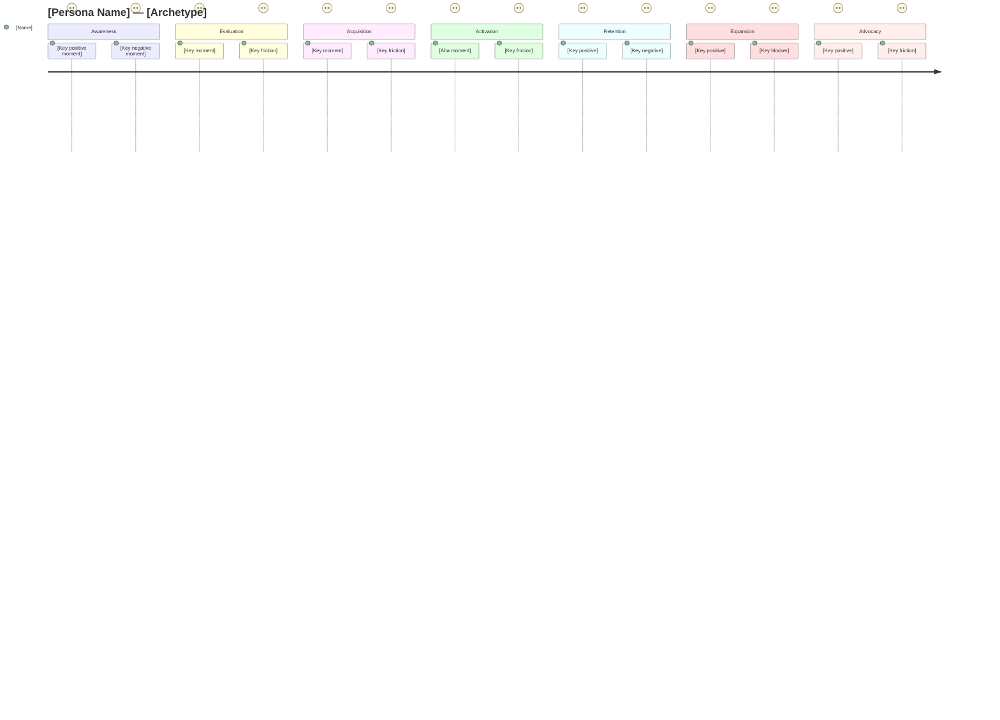

# User Journey Map Template

Use this template when creating a journey map via `/journey:create`. Map the journey for a specific persona — do not create a generic "user" journey. Each stage should contain concrete, specific details, not abstract descriptions.

---

```markdown
# [Persona Name] — User Journey Map

**Persona:** [Link to persona file, e.g., `meta/personas/ai-native-founder.md`]
**Persona role:** `primary` | `secondary`
**Confidence:** `proto-journey` | `interview-informed` | `data-validated`
**Created:** [Date]
**Last reviewed:** [Date]
**Next review:** [Date — 6-month cadence]

---

## Emotional Arc

Include a Mermaid `journey` diagram at the top of every journey map. This provides a visual emotional arc that's scannable at a glance — showing peaks and valleys across all 7 stages. The diagram renders natively in GitHub, Fumadocs, and VS Code with the Mermaid extension.

Each stage should have 1-2 entries with emotion scores from 1 (worst) to 5 (best). Use short, descriptive labels that capture the key moment.
```



```markdown
**Scoring guide:**
- **5** — Delight, "aha moment", strong positive emotion
- **4** — Satisfaction, confidence, things working as expected
- **3** — Neutral, cautious, mixed feelings
- **2** — Frustration, confusion, friction
- **1** — Blocked, angry, about to abandon

**Tips:**
- The arc should have peaks AND valleys — a flat line means the journey isn't specific enough
- Label each entry with a concrete moment, not a vague feeling ("Dashboard confetti fires: 5" not "Feels good: 5")
- If every stage scores 3-4, you're being too generous — find the real pain points

---

## Stage 1: Awareness

> The persona first encounters the problem or the solution category.

| Dimension | Details |
|-----------|---------|
| **Trigger event** | [What specific event causes them to realize they have this problem?] |
| **Actions** | [What do they do?] |
| **Touchpoints** | [Where do they encounter us?] |
| **Questions** | [What do they need answered?] |
| **Emotions** | [How do they feel?] |
| **Pain points** | [What creates friction?] |
| **Our content/UX** | [What do we have or need here?] |
| **Success metric** | [How do we know they advanced?] |
| **Opportunity** | [Our biggest lever at this stage?] |

---

## Stage 2: Evaluation

> They are actively comparing solutions and forming opinions quickly.

| Dimension | Details |
|-----------|---------|
| **Actions** | [What do they do during evaluation?] |
| **Touchpoints** | [Where do they evaluate us?] |
| **Questions** | [What do they need answered?] |
| **Emotions** | [How do they feel?] |
| **Pain points** | [What creates friction?] |
| **Our content/UX** | [What we need here] |
| **Success metric** | [How do we know they advanced?] |
| **Opportunity** | [Our biggest lever?] |

---

## Stage 3: Acquisition

> They decide to try it. Every friction point is a potential drop-off.

| Dimension | Details |
|-----------|---------|
| **Actions** | [What do they do to get started?] |
| **Touchpoints** | [What do they interact with?] |
| **Questions** | [What do they need answered?] |
| **Emotions** | [How do they feel?] |
| **Pain points** | [Specific friction points in our setup flow] |
| **Our content/UX** | [What we need here] |
| **Success metric** | [How do we know they succeeded?] |
| **Opportunity** | [Our biggest lever?] |

---

## Stage 4: Activation

> First time the persona gets real value. This is the "aha moment."

| Dimension | Details |
|-----------|---------|
| **Actions** | [What do they do when they first get value?] |
| **Touchpoints** | [What do they interact with?] |
| **Questions** | [What do they need answered?] |
| **Emotions** | [How do they feel?] |
| **Pain points** | [What creates friction at activation?] |
| **Our content/UX** | [What we need here] |
| **Success metric** | [How do we know they activated?] |
| **Opportunity** | [Our biggest lever?] |

---

## Stage 5: Retention

> Regular use. It's in their workflow. Does it keep delivering value?

| Dimension | Details |
|-----------|---------|
| **Actions** | [What do they do regularly?] |
| **Touchpoints** | [What do they interact with?] |
| **Questions** | [What do they wonder about?] |
| **Emotions** | [How do they feel?] |
| **Pain points** | [What causes friction in ongoing use?] |
| **Our content/UX** | [What we need here] |
| **Success metric** | [How do we measure retention?] |
| **Opportunity** | [Our biggest lever?] |

---

## Stage 6: Expansion

> They advocate internally, add teammates, or expand scope.

| Dimension | Details |
|-----------|---------|
| **Actions** | [What do they do to expand?] |
| **Touchpoints** | [What do they interact with?] |
| **Questions** | [What do they need answered?] |
| **Emotions** | [How do they feel?] |
| **Pain points** | [What blocks expansion?] |
| **Our content/UX** | [What we need here] |
| **Success metric** | [How do we measure expansion?] |
| **Opportunity** | [Our biggest lever?] |

---

## Stage 7: Advocacy

> They tell others. For developer tools, word of mouth is the most trusted channel.

| Dimension | Details |
|-----------|---------|
| **Actions** | [What do they do to advocate?] |
| **Touchpoints** | [Where do they advocate?] |
| **Questions** | [What do they want to know?] |
| **Emotions** | [How do they feel?] |
| **Pain points** | [What limits advocacy?] |
| **Our content/UX** | [What we need here] |
| **Success metric** | [How do we measure advocacy?] |
| **Opportunity** | [Our biggest lever?] |

---

## Journey Summary

| Stage | Key Emotion | Biggest Friction | Top Opportunity |
|-------|-------------|------------------|-----------------|
| Awareness | | | |
| Evaluation | | | |
| Acquisition | | | |
| Activation | | | |
| Retention | | | |
| Expansion | | | |
| Advocacy | | | |
```
